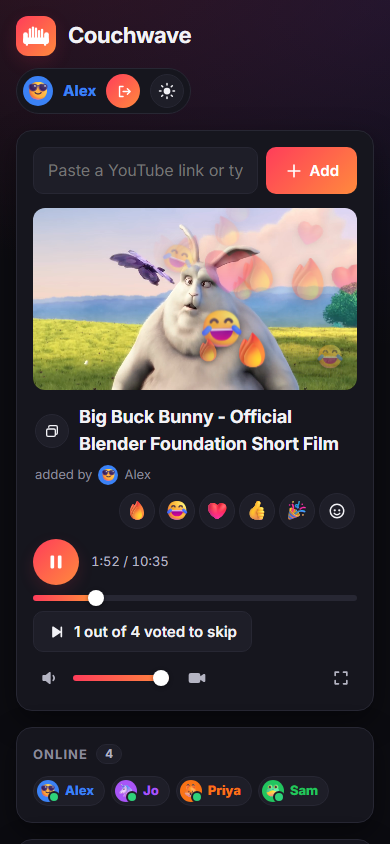

<p align="center"></p>

<h1 align="center">Couchwave</h1>

<p align="center"><b>Watch YouTube together with your friends, from your own computer.</b></p>

Everyone opens the same page, pastes YouTube links (or just types a song name) into a shared queue, and
the videos play in sync for everybody, with chat and emoji reactions on the side. It's like sitting on
the same couch, wherever you are. You host it yourself, it's password-protected, and it needs nothing
but Node.js, yt-dlp and ffmpeg. No accounts, no database, no npm packages.


<details>
<summary>On a phone</summary>



</details>

## What it does

- **Shared queue**: paste a link, a playlist, or a song name. People take turns: one person's 100-song
  playlist doesn't drown out everyone else. Drag to reorder, delete your own songs (with undo), copy links.
- **In sync**: play, pause and seek for everyone, and vote to skip (more than half of the people online
  skips the song; whoever added it can skip it straight away). Your own volume stays yours, and so does
  **audio-only** mode: turn the video off to just listen (and save data).
- **Chat, reactions and who's online**, with emoji profile pictures and colours. Messages, votes and
  songs changing show up for everyone instantly.
- **Keeps playing on a locked phone**, and can be installed as an app ("Add to Home screen").
- **Remembers everything** across restarts: the queue, what was playing and where, the chat and the activity log.

Songs are downloaded to your computer with [yt-dlp](https://github.com/yt-dlp/yt-dlp) a few at a time
ahead of when they play, and deleted after they've played.

## Setup

You need **Node.js 18 or newer**, **yt-dlp** and **ffmpeg**.

### Windows

1. Install the tools. Open PowerShell and run:

   ```powershell
   winget install OpenJS.NodeJS.LTS
   winget install yt-dlp.yt-dlp
   ```

   (The yt-dlp package brings ffmpeg with it.) Close and reopen PowerShell afterwards.

2. Get Couchwave: download it from GitHub (**Code → Download ZIP**, then unzip it), or
   `git clone https://github.com/Hoyle95/couchwave.git`.

3. Double-click **`start.cmd`** in the Couchwave folder and keep the window open.

4. Open <http://localhost:3000>. The password is in **`config.json`**, which is created the first time
   it runs. Change the password or the port there; the server restarts by itself when you save.

### Linux (Debian, Ubuntu, Raspberry Pi OS)

1. Install the tools:

   ```sh
   sudo apt update
   sudo apt install -y nodejs ffmpeg python3 git curl
   node --version    # needs v18 or newer
   mkdir -p ~/.local/bin
   curl -L https://github.com/yt-dlp/yt-dlp/releases/latest/download/yt-dlp -o ~/.local/bin/yt-dlp
   chmod +x ~/.local/bin/yt-dlp
   export PATH="$HOME/.local/bin:$PATH"
   ```

   yt-dlp is installed from its own release rather than `apt` so that Couchwave can keep it up to date
   (YouTube changes often, and old versions stop working). If `node --version` is older than 18, install a
   newer Node from [nodejs.org](https://nodejs.org/en/download). On other distros, install the same
   things with your package manager.

2. Get Couchwave and start it:

   ```sh
   git clone https://github.com/Hoyle95/couchwave.git
   cd couchwave
   node server.js
   ```

3. Open <http://localhost:3000> (or `http://<this machine's IP>:3000` from another device). The password
   is printed on the first run and saved in **`config.json`**. Change the password or the port there and restart.

## Keep it running

### Windows: start with the PC

Open PowerShell **as administrator** in the Couchwave folder and run:

```powershell
$action = New-ScheduledTaskAction -Execute 'cmd.exe' -Argument '/c start.cmd' -WorkingDirectory "$PWD"
$settings = New-ScheduledTaskSettingsSet -ExecutionTimeLimit 0 -AllowStartIfOnBatteries -DontStopIfGoingOnBatteries
Register-ScheduledTask -TaskName Couchwave -Action $action -Trigger (New-ScheduledTaskTrigger -AtStartup) `
  -Principal (New-ScheduledTaskPrincipal -UserId $env:USERNAME -LogonType S4U) -Settings $settings -Force
```

It then starts at boot (no need to log in) and restarts itself if it ever crashes. Stop or start it with
`Stop-ScheduledTask Couchwave` / `Start-ScheduledTask Couchwave`. If you move the Couchwave folder, run
the same commands again from its new place.

### Linux: run as a service

From the Couchwave folder:

```sh
sudo tee /etc/systemd/system/couchwave.service > /dev/null <<EOF
[Unit]
Description=Couchwave
After=network-online.target
Wants=network-online.target

[Service]
User=$USER
WorkingDirectory=$PWD
Environment=PATH=$HOME/.local/bin:/usr/local/bin:/usr/bin:/bin
ExecStart=/usr/bin/env node server.js
Restart=always

[Install]
WantedBy=multi-user.target
EOF
sudo systemctl enable --now couchwave
```

Restart it after changing `config.json` or updating: `sudo systemctl restart couchwave`.

## Letting friends in

On your home network, friends open `http://<this machine's IP>:3000` (or the port you set in
`config.json`).

To host it publicly, we recommend either:

- **[Cloudflare Tunnel](https://developers.cloudflare.com/tunnel/setup/)**: free, gives you an `https://`
  address, and needs no ports opened on your router.
- **[Caddy](https://caddyserver.com/docs/quick-starts/reverse-proxy)**: a web server that gets an
  `https://` certificate for your domain automatically. This Caddyfile is all it needs:

  ```
  couch.example.com {
      reverse_proxy localhost:3000
  }
  ```

Either way, use `https://`: the password and everyone's login are sent over it, and phones only offer
"Install app" on secure sites.

**Joining**: give friends the room password (from `config.json`). The first time they join, they pick a
nickname and their own password for it. That keeps the nickname theirs: nobody else can join as them, even
with the room password. Nicknames ignore capitals ("matt" is "Matt"). Their browser stays logged in for a
year, so they only type it again on a new device.

## Settings, data and backups

- **`config.json`**: the password and port (3000 unless you change it). Made on the first run.
- **`data/`**: everything Couchwave saves: the queue, chat, activity log and profile pictures
  (`state.json`), the nicknames and their (scrambled) passwords (`accounts.json`), the downloaded songs,
  and the logs.

**To back up, copy the `data/` folder.** To restore, stop Couchwave and put it back.

**To log everyone out** (they'll need to enter the password again), run this in the Couchwave folder,
while it's running or not:

```sh
node server.js --logout-everyone
```

Changing the password in `config.json` logs everyone out too.

**Someone forgot their password** (or took a nickname that isn't theirs): free the nickname, and whoever
joins with it next chooses its new password. They're logged out wherever they were logged in as it.

```sh
node server.js --forget-name LVJ
```

**To update**, download the new version (or `git pull`) over the old one. `config.json` and `data/` are
kept. On Windows it restarts by itself; on Linux, restart the service.

## Troubleshooting

- **Songs fail with "Blocked by YouTube" or "bot check"**: yt-dlp updates itself once a day, but YouTube
  sometimes changes faster. Run `yt-dlp -U` and press the retry button on the song.
- **Won't start**: look at `data/server.log` and `data/server-console.log`. A broken `config.json` is the
  usual cause; the log says what's wrong.

## Running the tests

After changing the code, check nothing broke:

```
node --test
```

It takes about 25 seconds and needs nothing installed. Each test starts its own throwaway Couchwave in a
temporary folder, with its own password and port, so your real server, songs and chat are never touched
(it can run while Couchwave is running). Instead of yt-dlp and ffmpeg it uses stand-ins in `tests/fakes/`
that act like them in a split second, without YouTube, including failures, livestreams and playlists.

The tests cover logging in, adding songs (links, searches, playlists), downloads failing and retrying,
deleting with undo, the fair queue, pause/seek/skip, voting to skip, who's online and joined/left, chat
and instant updates, the video files and their pacing, and that the page's scripts have no syntax errors.

## Feedback

Got an idea, found a bug, or just want to say hi? Join our [Discord](https://discord.com/invite/pNtyzNkch6) or [open an issue](https://github.com/Hoyle95/couchwave/issues) on GitHub.

## Credits

Vibe coded by [Matt Hoyle](https://matthoyle.me/) using Claude Opus 5.5.

The screenshot shows [Big Buck Bunny](https://peach.blender.org/) © Blender Foundation, CC BY 3.0. The font is [Inter](https://rsms.me/inter/) (SIL Open Font License, see `fonts/OFL.txt`), included so the site never loads anything from Google.

## Licence

Copyright 2026 [Hoyle95](https://github.com/Hoyle95). The code is open source under the [Apache License 2.0](LICENSE): you can use,
change and share it, including in your own projects.

**The name and logo are not included.** "Couchwave" and the couch-and-wave logo (in `icons/` and in
the page itself) are not covered by the licence. If you share your own version, please give it a
different name and logo. Saying it's "based on Couchwave" is fine.
