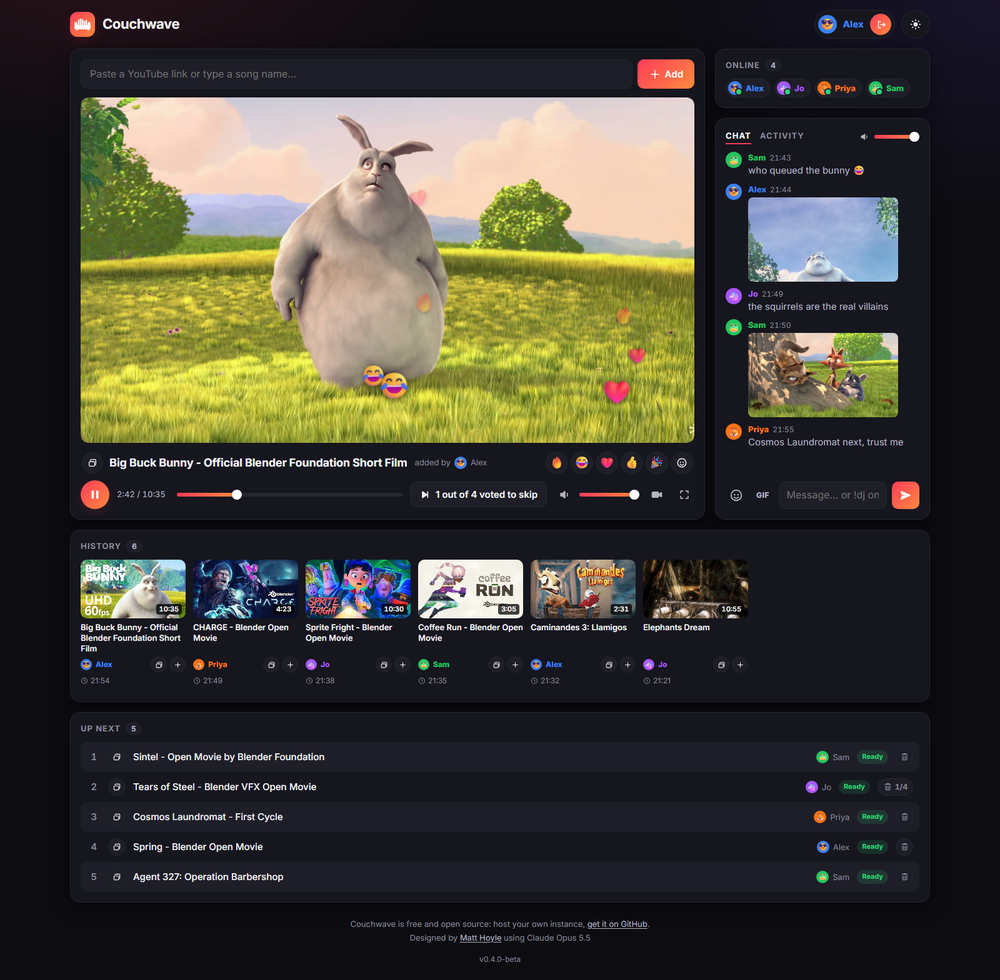

<h1 align="center">Couchwave</h1>

<b>Watch YouTube together with your friends, from your own computer.</b>

Everyone opens the same page, pastes YouTube links (or just types a song name) into a shared queue, and
the videos play in sync for everybody, with chat and emoji reactions on the side. It's like sitting on
the same couch, wherever you are. You host it yourself, it's password-protected, and it needs nothing
but Node.js, yt-dlp and ffmpeg. No sign-up emails, no database, no npm packages.

On a phone

## What it does

- **Shared queue**: paste a link, a playlist, or a song name. People take turns: one person's 100-song
  playlist doesn't drown out everyone else. Remove your own songs, or vote to remove anyone's (with
  undo), copy links.
- **In sync**: play, pause and seek for everyone, and vote to skip (more than half of the people online
  skips the song; whoever added it can skip it straight away). Your own volume stays yours, and so does
  **audio-only** mode: turn the video off to just listen (and save data).
- **Chat, reactions and who's online**, with emoji profile pictures and colours. Messages, votes and
  songs changing show up for everyone instantly.
- **A DJ** to keep the music going: type `!dj on` in the chat and it keeps up to 10 songs queued, like
  what people have been asking for, always after everyone else's.
  `!dj off` stops it. It's off until someone turns it on.
- **History**: the last 100 songs played, with who asked for them and when, and their links to copy.
- **Your own nickname**, with its own password, so nobody else can join as you.
- **Keeps playing on a locked phone**, and can be installed as an app ("Add to Home screen").
- **Remembers everything** across restarts: the queue, what was playing and where, the chat and the activity log.

Songs are downloaded to your computer with [yt-dlp](https://github.com/yt-dlp/yt-dlp) a few at a time
ahead of when they play, and deleted after they've played.

## Getting started

1. Install Node.js, yt-dlp and ffmpeg, then start Couchwave. Step-by-step instructions at **[docs/INSTALL.md](docs/INSTALL.md)**.
2. Open <http://localhost:3000>. The room password is in **`config.json`**, made the first time it runs.
3. Give your friends the address and the room password.

Logging everyone out, deleting an account or resetting a forgotten password are one command each:
**[docs/COMMANDS.md](docs/COMMANDS.md)**.

## Joining

Joining takes two things:

- **The room password**: the same for everyone, from `config.json`. It keeps strangers out.
- **A nickname and its own password**: chosen the first time someone joins with that nickname. It keeps
  the nickname theirs, so nobody else can join as them, even with the room password. Nicknames ignore
  capitals ("matt" is "Matt").

Browsers stay logged in for a year, so people only type them again on a new device. Forgotten password?
The admin can set a new one with [`--set-password`](docs/COMMANDS.md#set-a-new-password).

## Settings, data and backups

- **`config.json`**: the room password and port (3000 unless you change it). Made on the first run.
- **`data/`**: everything Couchwave saves: the queue, chat, activity log and profile pictures
  (`state.json`), the accounts with their passwords scrambled, never as typed (`accounts.json`), the
  downloaded songs, and the logs.

**To back up, copy the `data/` folder.** To restore, stop Couchwave and put it back.

## Troubleshooting

- **Songs fail with "Blocked by YouTube" or "bot check"**: yt-dlp updates itself once a day, but YouTube
  sometimes changes faster. Run `yt-dlp -U` and press the retry button on the song.
- **Won't start**: look at `data/server.log` and `data/server-console.log`. A broken `config.json` is the
  usual cause; the log says what's wrong.
- **"Logins are paused"** on the join screen: Couchwave can't read `data/accounts.json`, e.g. it was
  edited by hand and broken. People already logged in carry on; the log says what's wrong.

## Feedback

Got an idea, found a bug, or just want to say hi? Join our [Discord](https://discord.com/invite/pNtyzNkch6) or [open an issue](https://github.com/Hoyle95/couchwave/issues) on GitHub.

## Credits

Vibe coded by [Matt Hoyle](https://matthoyle.me/) using Claude Opus 5.5.

The screenshot shows [Big Buck Bunny](https://peach.blender.org/) © Blender Foundation, CC BY 3.0. The font is [Inter](https://rsms.me/inter/) (SIL Open Font License, see `fonts/OFL.txt`), included so the site never loads anything from Google.

## Licence

Copyright 2026 [Hoyle95](https://github.com/Hoyle95). The code is open source under the [Apache License 2.0](LICENSE): you can use,
change and share it, including in your own projects.

**The name and logo are not included.** "Couchwave" and the couch-and-wave logo (in `icons/` and in
the page itself) are not covered by the licence. If you share your own version, please give it a
different name and logo. Saying it's "based on Couchwave" is fine.
