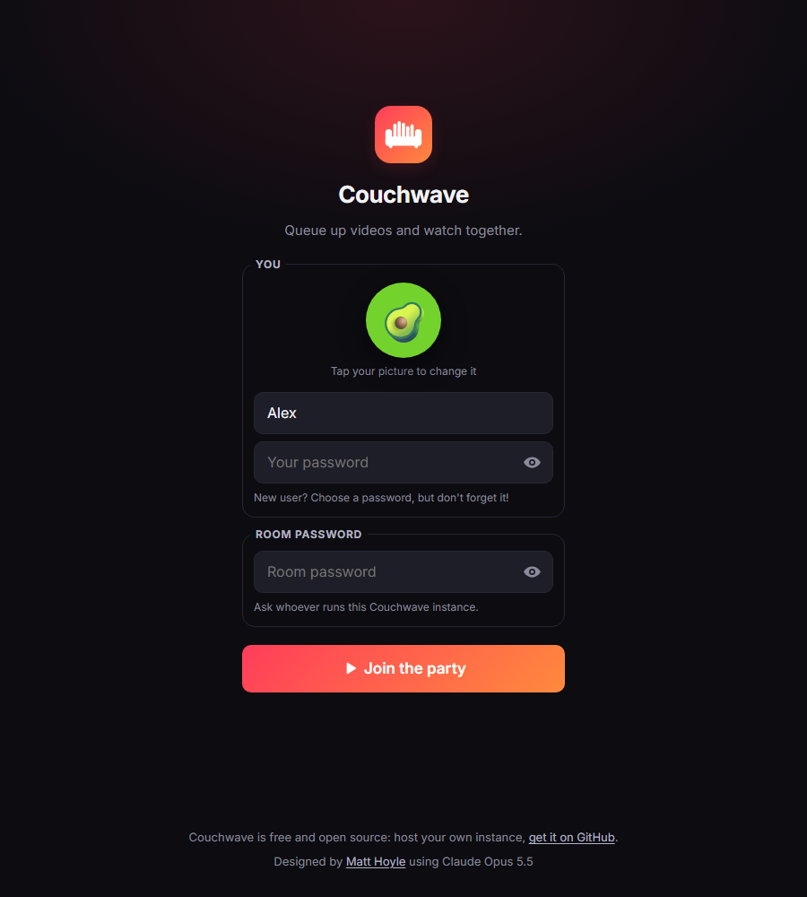

# Getting started and setup

You need **Node.js 18.11 or newer**, **yt-dlp** and **ffmpeg**.

- [Quick start](#quick-start)
- [Windows](#windows)
- [Linux (Debian, Ubuntu, Raspberry Pi OS)](#linux-debian-ubuntu-raspberry-pi-os)
- [Settings](#settings)
- [Your data](#your-data)
- [Keep it running](#keep-it-running)
- [Letting friends in](#letting-friends-in)
- [Updating](#updating)
- [Troubleshooting](#troubleshooting)

> [!NOTE]
> **We recommend downloading a release.** The [Releases page](https://github.com/Hoyle95/couchwave/releases)
> has tested versions. Cloning the repo or `git pull` gets the very latest code instead, which can include
> changes that haven't been fully tested yet. If you'd like to try the latest unreleased code anyway, we'd love
> to hear how it goes: tell us on [Discord](https://discord.com/invite/pNtyzNkch6) or
> [open an issue](https://github.com/Hoyle95/couchwave/issues).

## Quick start

1. Install it and start it: [Windows](#windows) or [Linux](#linux-debian-ubuntu-raspberry-pi-os).
2. Open <http://localhost:3000>. The room password is in `config.json`, made on the first run.
3. Send your friends the address and the room password (see [Letting friends in](#letting-friends-in)).
   The first time they join, they pick a nickname and a password for it.

<p align="center"></p>

## Windows

1. Install the tools. Open PowerShell and run:

   ```powershell
   winget install OpenJS.NodeJS.LTS
   winget install yt-dlp.yt-dlp
   ```

   (The yt-dlp package brings ffmpeg with it.) Close and reopen PowerShell afterwards.

2. Get Couchwave: on the [Releases page](https://github.com/Hoyle95/couchwave/releases), download
   **couchwave-…zip** under **Assets** of the newest release (not "Source code"). The zip has no folder of
   its own inside, so first make a new, empty folder where you want Couchwave to live (like
   `Documents\Couchwave`): that's your Couchwave folder. Then right-click the zip, choose **Extract All**,
   click **Browse**, and pick that folder.

3. Double-click **`start.cmd`** in the Couchwave folder and keep the window open.

4. Open <http://localhost:3000>. The room password is in **`config.json`**, which is created the first
   time it runs, along with the other [settings](#settings). The server restarts by itself when you save it.

## Linux (Debian, Ubuntu, Raspberry Pi OS)

1. Install the tools:

   ```sh
   sudo apt update
   sudo apt install -y nodejs ffmpeg python3 git curl unzip
   node --version    # needs v18.11 or newer
   mkdir -p ~/.local/bin
   curl -L https://github.com/yt-dlp/yt-dlp/releases/latest/download/yt-dlp -o ~/.local/bin/yt-dlp
   chmod +x ~/.local/bin/yt-dlp
   export PATH="$HOME/.local/bin:$PATH"
   ```

   yt-dlp is installed from its own release rather than `apt` so that Couchwave can keep it up to date
   (YouTube changes often, and old versions stop working). If `node --version` is older than 18.11, install a
   newer Node from [nodejs.org](https://nodejs.org/en/download). On other distros, install the same
   things with your package manager.

2. Get Couchwave (the latest release) and start it:

   ```sh
   git clone https://github.com/Hoyle95/couchwave.git
   cd couchwave
   git checkout "$(git describe --tags --abbrev=0 origin/main)"   # the latest release, not untested code
   node server.js
   ```

   Or download **couchwave-…zip** from the newest release on the
   [Releases page](https://github.com/Hoyle95/couchwave/releases) and unzip it into a new folder of its own
   (the zip has no folder inside), then start it from there:

   ```sh
   mkdir ~/couchwave
   unzip ~/Downloads/couchwave-v*.zip -d ~/couchwave
   cd ~/couchwave
   node server.js
   ```

3. Open <http://localhost:3000> (or `http://<this machine's IP>:3000` from another device). The room
   password is printed on the first run and saved in **`config.json`**, along with the other
   [settings](#settings). Restart Couchwave after changing them.

## Settings

Settings are in `config.json`, made on the first run. On Windows (`start.cmd`) Couchwave restarts by
itself when you save it; otherwise, restart it.

- `password`: the room password. Changing it logs everyone out.
- `port`: 3000 by default (any whole number from 1 to 65535).
- `votePercent`: how many of the people online have to vote to skip a song or remove someone else's.
  60 by default, so 2 of 3 or 3 of 5.
- `maxVideoHours`: how long any one video can be, in hours (each is downloaded in full to your computer).
  3 by default; any number works, like `1.5` (an hour and a half) or `0.25` (15 minutes).
- `downloadAhead`: how many songs at the top of the queue are downloaded ahead of time, so they play
  without waiting. 20 by default. The rest download as they move up, so a long playlist doesn't fill the disk.
- `downloadsAtOnce`: how many of those download at the same time. 3 by default. Fewer is gentler on a
  slow connection.
- `public`: see below. Keep it `false`.
- `trustProxy`: which proxies Couchwave believes when they say who's visiting and that the visit came over
  `https://` (see [Letting friends in](#letting-friends-in)). Most setups don't need it: by default it trusts
  proxies on this computer and on private networks (your home network, Docker, Tailscale). For a proxy
  anywhere else, like a rented server, list its address, or a range of them, and they're trusted as well:
  `"trustProxy": ["203.0.113.5"]` or `["10.8.0.0/24"]`. `false` trusts no proxy at all: only use it if nothing
  sits in front of Couchwave.
- `updateCheck`: once a day Couchwave asks GitHub whether there's a newer release, and if there is, says so in
  Activity and the log (it doesn't install anything, and nothing about you or your room is sent). `false`
  turns this off.
- `youtubeCookies`: only if YouTube keeps stopping downloads with its bot check, or a video only shows to
  signed-in accounts. It lets yt-dlp use a signed-in YouTube account, from either:
  - a cookies file, like `"youtubeCookies": "data/youtube-cookies.txt"`, exported from a browser where you're
    signed in to YouTube (in the Netscape `cookies.txt` format: see
    [yt-dlp's guide](https://github.com/yt-dlp/yt-dlp/wiki/Extractors#exporting-youtube-cookies)). Keep it in
    `data/`, so it's never shared or uploaded.
  - or a browser on this computer where you're signed in to YouTube: `"firefox"`, `"chrome"`, `"edge"`,
    `"brave"`, `"opera"`, `"vivaldi"`, `"chromium"` or `"safari"`. On Windows, Chrome and Edge's cookies
    usually can't be read; Firefox or a cookies file work.

  Use a spare Google account, not your main one: YouTube can block an account it thinks is a bot.

A setting missing from an older `config.json` uses its default.

> [!WARNING]
> **Keep `public` set to `false`.** With `"public": true` there's no room password: anyone who finds your
> address can join, chat, and add songs that **your computer then downloads**. Nicknames still have their
> own passwords, but strangers can simply make up new ones. We strongly recommend never turning it on,
> especially if Couchwave can be reached from the internet.

## Your data

Everything Couchwave saves is in `data/`: the queue, chat and history, the accounts (passwords scrambled,
never stored as typed) and who's logged in, the downloaded songs and the logs. **To back up, copy `data/`**
(and `config.json`). Downloads pause by themselves if the disk gets down to its last 2 GB, so Couchwave
never fills it. To wipe the chat, the Activity log or the played history, see `--clear` in the
[server commands](FEATURES.md#server-commands).

Couchwave also backs itself up once a day, into `data/backups/` (a folder for each day, keeping the last 7):
the accounts and logins, the queue, chat and history, and `config.json`. To go back to one, stop Couchwave,
copy that day's files back into `data/` (and `config.json` back into the Couchwave folder), and start it
again. For a copy somewhere safer, copy `data/backups/` to another drive now and then.

## Keep it running

### Windows: start with the PC

Open PowerShell **as administrator** in the Couchwave folder and run:

```powershell
$action = New-ScheduledTaskAction -Execute 'cmd.exe' -Argument '/c start.cmd' -WorkingDirectory "$PWD"
$settings = New-ScheduledTaskSettingsSet -ExecutionTimeLimit 0 -AllowStartIfOnBatteries -DontStopIfGoingOnBatteries
Register-ScheduledTask -TaskName Couchwave -Action $action -Trigger (New-ScheduledTaskTrigger -AtStartup) `
  -Principal (New-ScheduledTaskPrincipal -UserId $env:USERNAME -LogonType S4U) -Settings $settings -Force
```

It then starts at boot (no need to log in) and restarts itself if it ever crashes. If you move the
Couchwave folder, run the same commands again from its new place.

To stop it: `Stop-ScheduledTask Couchwave`, then end the leftover **Node.js** process in Task Manager
(stopping the task alone can leave the server running). To start it again: `Start-ScheduledTask Couchwave`.

### Linux: run as a service

From the Couchwave folder:

```sh
sudo tee /etc/systemd/system/couchwave.service > /dev/null <<EOF
[Unit]
Description=Couchwave
After=network-online.target
Wants=network-online.target

[Service]
User=$USER
WorkingDirectory=$PWD
Environment=PATH=$HOME/.local/bin:/usr/local/bin:/usr/bin:/bin
ExecStart=/usr/bin/env node server.js
Restart=always

[Install]
WantedBy=multi-user.target
EOF
sudo systemctl enable --now couchwave
```

Restart it after changing `config.json` or updating: `sudo systemctl restart couchwave`.

## Letting friends in

On your home network, friends open `http://<this machine's IP>:3000` (or the port you set in
`config.json`). To find the IP, run `ipconfig` on Windows (the **IPv4 Address**, like `192.168.1.20`) or
`hostname -I` on Linux. The first time Couchwave runs, Windows asks whether Node.js may use the network:
allow it on **private networks**, or friends can't connect (see [Troubleshooting](#troubleshooting) if you
missed it).

To host it publicly, we recommend either:

- **[Cloudflare Tunnel](https://developers.cloudflare.com/tunnel/setup/)**: free, gives you an `https://`
  address, and needs no ports opened on your router.
- **[Caddy](https://caddyserver.com/docs/quick-starts/reverse-proxy)**: a web server that gets an
  `https://` certificate for your domain automatically. This Caddyfile is all it needs:

  ```
  couch.example.com {
      reverse_proxy localhost:3000
  }
  ```

Either way, use `https://`: the passwords and everyone's login are sent over it, and phones only offer
"Install app" on secure sites. Both tell Couchwave who's visiting and that the visit came over `https://`,
so it marks logins HTTPS-only (never sent unencrypted) and counts wrong passwords for each visitor, not for
everyone at once. They can run on this computer or another one on your home network (in Docker, on a NAS,
over Tailscale).

Other proxies work too, as long as they send `X-Forwarded-For` (who's visiting) and `X-Forwarded-Proto`
(`http` or `https`). For nginx, add these two lines next to its `proxy_pass`:

```
proxy_set_header X-Forwarded-For $proxy_add_x_forwarded_for;
proxy_set_header X-Forwarded-Proto $scheme;
```

A proxy that isn't on this computer or your home network (say, on a rented server) also needs its address
in [`trustProxy`](#settings).

Then send your friends the address and the room password. The first time they join, they pick a nickname
and a password for it. To log someone out, reset a forgotten password or delete an account, see the
[server commands](FEATURES.md#server-commands).

## Updating

Couchwave tells you when there's a new release: a line in Activity (and the log) says "a newer Couchwave
is out". Your settings and everything people have done are kept: `config.json` and `data/` aren't part of
the download, so updating never touches them. To see what's changed first, read the
[changelog](../CHANGELOG.md).

**Recommended: the newest release.**

1. Download **couchwave-…zip** (not "Source code") from the newest release on the
   [Releases page](https://github.com/Hoyle95/couchwave/releases).
2. Stop Couchwave first, so it doesn't start up halfway through with some old files and some new ones. On
   Windows, close the `start.cmd` window (if it starts with the PC: `Stop-ScheduledTask Couchwave`, then end
   the leftover **Node.js** process in Task Manager). On Linux, `sudo systemctl stop couchwave`.
3. Unzip it into your Couchwave folder, replacing the old files. On Windows: **Extract All**, **Browse** to
   your Couchwave folder, and choose to replace the files. On Linux:
   `unzip -o ~/Downloads/couchwave-v*.zip -d ~/couchwave` (or wherever your Couchwave folder is). Your
   `config.json` and `data/` aren't in the zip, so they stay as they are. If the changelog says some files
   moved or were removed, delete the old ones it names.
4. Start it again: double-click `start.cmd` (or `Start-ScheduledTask Couchwave`), or on Linux
   `sudo systemctl start couchwave`.

**With `git`, staying on releases** (as set up in the Linux steps above), from the Couchwave folder:

```sh
git fetch --tags
git checkout "$(git describe --tags --abbrev=0 origin/main)"
```

then restart Couchwave (on Linux, `sudo systemctl restart couchwave`).

**The very latest code** (not recommended): `git checkout main`, then `git pull`. This gets every change
as soon as it's made, before it's been released, so now and then something may not work yet. If `git`
says your local changes would be overwritten, you've edited one of Couchwave's own files: `git stash`
puts your changes aside, then try again (`git stash pop` brings them back).

Everyone else just refreshes the page. Settings added in a new version use their defaults until you add
them to `config.json` (see [Settings](#settings)).

## Troubleshooting

- **Songs fail with "Blocked by YouTube" or "bot check"**: run `yt-dlp -U`, then press the song's retry
  button. (Couchwave updates yt-dlp daily, but YouTube sometimes changes faster.) If it keeps happening,
  YouTube may be checking your connection after a lot of downloads at once; it usually passes within a few
  hours. If it keeps coming back, see `youtubeCookies` in the [settings](#settings). If it's just **one
  song**, again and again, while others download fine, YouTube wants a signed-in account for that video:
  remove it and pick another version of the song (or use `youtubeCookies`). If it's someone else's, `node
  server.js --remove-song <its number in the queue>` takes it out without a vote (see the
  [server commands](FEATURES.md#server-commands)).
- **Activity says "yt-dlp can't update itself here"**: yt-dlp was installed with pip or a package manager
  (like `apt`), which won't let it update itself, so it goes out of date as YouTube changes. Update it the same
  way now and then (`pip install -U yt-dlp`, or your package manager), or install it as in the steps for
  [Linux](#linux-debian-ubuntu-raspberry-pi-os) so Couchwave can keep it up to date.
- **To check on Couchwave**: `node server.js --status` in the Couchwave folder says whether it's running,
  who's online, what's playing, how the queue is doing, the free disk space, the versions of its tools and
  whether there's a newer Couchwave.
- **Friends on your network can't connect** (but <http://localhost:3000> works for you): check they're using
  this machine's IP, not `localhost`. On Windows, allow Node.js through the firewall: **Windows Security** →
  **Firewall & network protection** → **Allow an app through firewall** → tick **Private** for Node.js. On
  Linux with `ufw` turned on: `sudo ufw allow 3000/tcp`.
- **Activity says "can't find yt-dlp" (or ffmpeg, or ffprobe)**: that program isn't installed, or Couchwave
  can't see it. Install it as in the steps for [Windows](#windows) or
  [Linux](#linux-debian-ubuntu-raspberry-pi-os), then restart Couchwave. On Windows, close and reopen PowerShell (or restart the PC) after installing.
- **Songs show "Disk full"**: the disk Couchwave is on has less than 2 GB free, so downloads have paused.
  Free up some space and they carry on by themselves within a minute.
- **A song shows "Download stalled"**: its download stopped getting anywhere for 5 minutes, so Couchwave
  stopped it and tries again shortly. If it keeps happening, check this computer's internet connection.
- **Won't start**: the reason is in `data/server.log`. Usually it's a broken `config.json`, or "port … is
  already in use": Couchwave (or something else) is already running on that port. Close it, or pick another
  `port` in `config.json`.
- **"Logins are paused"**: `data/accounts.json` can't be read (e.g. a bad hand edit). The log says why.
- **The queue, chat and history are suddenly empty**: `data/state.json` couldn't be read (the log says why).
  The old file is kept beside it as `state.json.broken-…`, in case you want to look at it or put it back.
- **"Too many wrong passwords for …"**: someone typed the wrong password for that nickname 20 times in 15
  minutes, so new logins with it wait 15 minutes (restarting Couchwave clears it straight away). Devices
  already logged in with it carry on as normal. If it's a forgotten password, see `--set-password` in the
  [server commands](FEATURES.md#server-commands).
- **"Too many wrong passwords, try again later"** for everyone at once, behind a proxy: Couchwave can't tell
  your visitors apart. Check the proxy sends `X-Forwarded-For`, and if it isn't on this computer or your home
  network, add its address to `trustProxy` (see [Letting friends in](#letting-friends-in)).
- **"Lots of new nicknames have been made from here"**: 10 new nicknames came from the same address within
  an hour (a guard against someone making endless accounts). It clears after an hour, or when Couchwave
  restarts. The computer running Couchwave isn't limited.
- **The log says someone reached Couchwave "straight from the internet over plain http"**: a port on your
  router leads straight to Couchwave, so passwords travel unencrypted. Close that port and use Cloudflare
  Tunnel or Caddy instead (see [Letting friends in](#letting-friends-in)).
